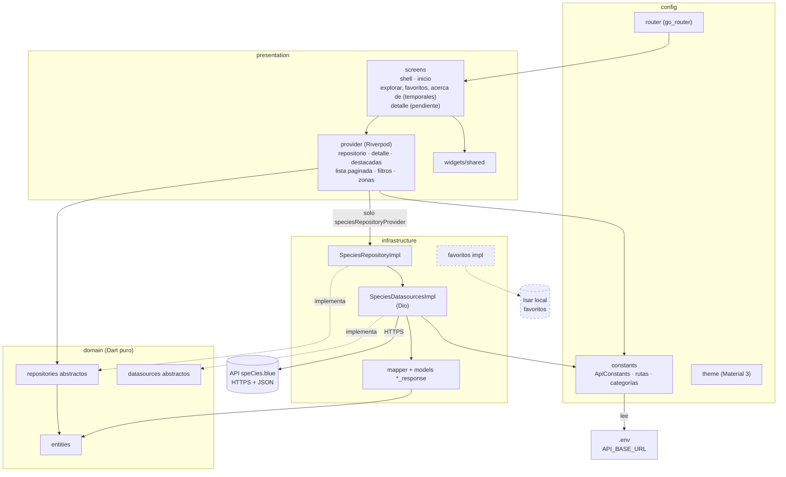
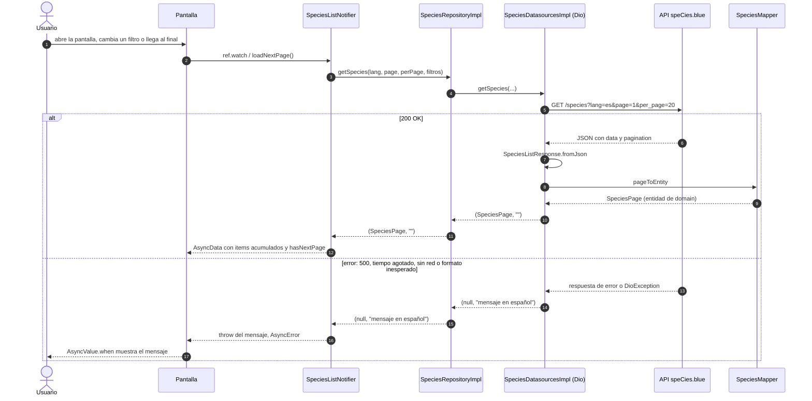

# marine_app

App Flutter para explorar las 1,505 especies marinas de la API pública speCies.blue, con búsqueda, filtros y favoritos guardados en el dispositivo.

## Cómo funciona

### Arquitectura por capas

Las flechas van de quien depende hacia lo que usa. Las cajas punteadas están pendientes.



Reglas: `domain` no depende de nada; `presentation` solo conoce `domain` (con una excepción: el provider que construye el repositorio); `infrastructure` solo conoce `domain` y `config`.

### Petición de una página de `/species`

Así se carga una página de especies, con el camino de error. Hoy lo recorre Inicio con las destacadas; Explorar usará el mismo camino (pendiente).



## Ejecutar

```bash
flutter pub get
cp .env.example .env    # en PowerShell: Copy-Item .env.example .env
flutter run
```

Completa `API_BASE_URL` en el `.env` con `https://skfqeznlqqprmvamwyrf.supabase.co/functions/v1/public-api/v1`. El `.env` no se versiona.

## Atribución

Datos de [speCies.blue](https://species.blue), bajo licencia [CC BY-SA 4.0](https://creativecommons.org/licenses/by-sa/4.0/).
