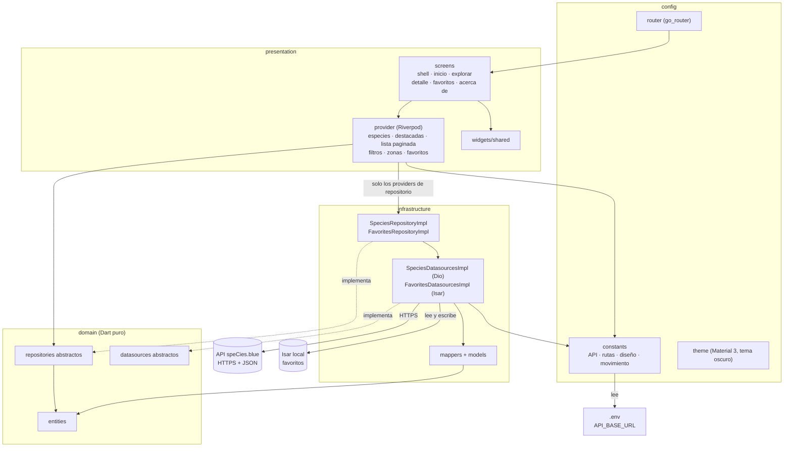
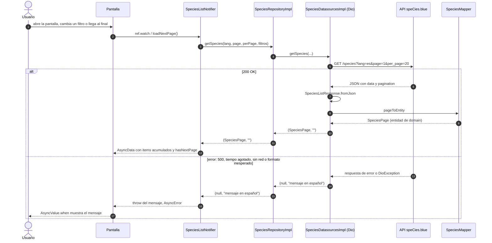
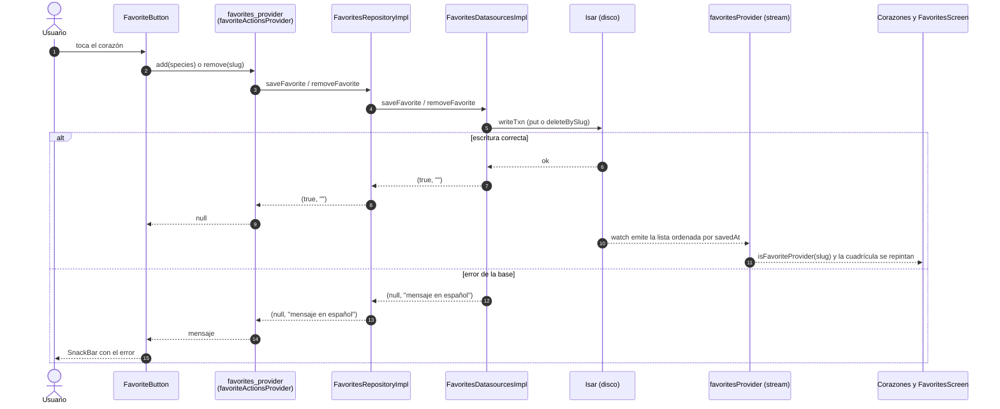

# marine_app

Guía de campo de la vida marina para buceadores. App Flutter para explorar las 1,505 especies de la API pública speCies.blue, con búsqueda, filtros, ficha de cada especie y favoritos guardados en el dispositivo que se ven sin conexión.

## Pantallas

| Ruta | Pantalla | Qué hace |
| --- | --- | --- |
| `/` | Inicio | Héroe cover-flow de especies destacadas, atajo a aguas profundas, 13 grupos y mosaico "Descubre más". |
| `/explore` | Explorar | Búsqueda por texto y filtros (grupo, estado UICN, peligrosidad, profundidad y tamaño). Cuadrícula con scroll infinito. |
| `/favorites` | Favoritos | Cuadrícula de las especies guardadas, leída de la base local. |
| `/about` | Acerca de | Atribución a speCies.blue y aviso de fotos. |
| `/species/:slug` | Detalle | Foto a sangre, estado UICN, peligrosidad, medidor de profundidad, barra de tamaño, hábitats, comportamientos, zonas y taxonomía. |

## Cómo funciona

### Arquitectura por capas

Las flechas van de quien depende hacia lo que usa.



Reglas: `domain` no depende de nada; `presentation` solo conoce `domain` (con una excepción: los providers que construyen cada repositorio); `infrastructure` solo conoce `domain` y `config`.

### Petición de una página de `/species`

Así se carga una página de especies, con el camino de error. Lo recorren Explorar (lista paginada) y Inicio (destacadas y mosaico).



Con texto en el buscador, Explorar usa `/search` en lugar de `/species`: esa ruta no pagina ni admite filtros.

### Favoritos con Isar

Los favoritos se guardan como una copia mínima de la especie, así la cuadrícula se ve sin red. La base es la única fuente: los corazones y la pantalla leen el mismo stream.



## Diseño

- Material 3 solo desde `material_ui`, tema oscuro forzado y Montserrat.
- Todos los colores salen de `OceanPalette` (`ThemeExtension` en `config/theme/app_theme.dart`) o del `colorScheme`: cuatro tonos de profundidad, escala UICN y un color por grupo.
- Duraciones, curvas, medidas y rutas viven en `config/constants/`, no en los widgets.
- Los filtros de profundidad y tamaño de la API funcionan por solapamiento, hacia un solo lado: la app los presenta como "llegan al menos a X m" y "alcanzan al menos X cm".

## Ejecutar

```bash
flutter pub get
cp .env.example .env    # en PowerShell: Copy-Item .env.example .env
flutter run
```

Completa `API_BASE_URL` en el `.env` con `https://skfqeznlqqprmvamwyrf.supabase.co/functions/v1/public-api/v1`. El `.env` no se versiona y viaja como asset dentro de la app, por eso solo debe llevar valores públicos.

Los modelos de Isar generan código. Si cambias `favorite_species_collection.dart`:

```bash
dart run build_runner build
```

## Atribución

Datos de [speCies.blue](https://species.blue), bajo licencia [CC BY-SA 4.0](https://creativecommons.org/licenses/by-sa/4.0/).

Las fotos provienen de distintas fuentes, como iNaturalist y Wikimedia Commons; cada foto muestra su crédito y licencia en la ficha de la especie.
